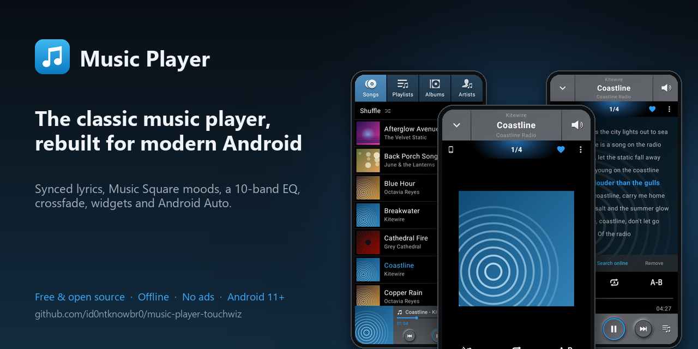
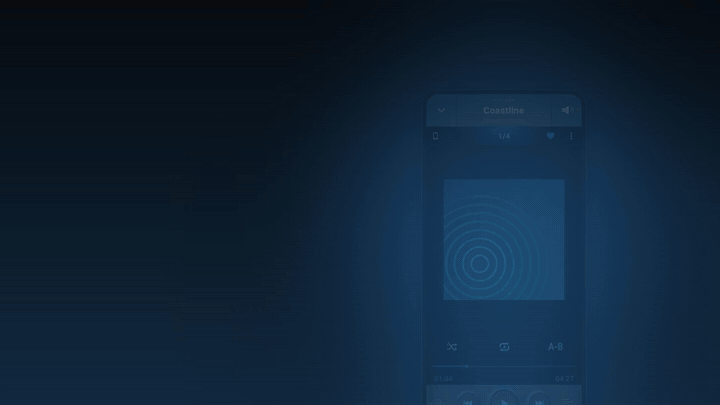
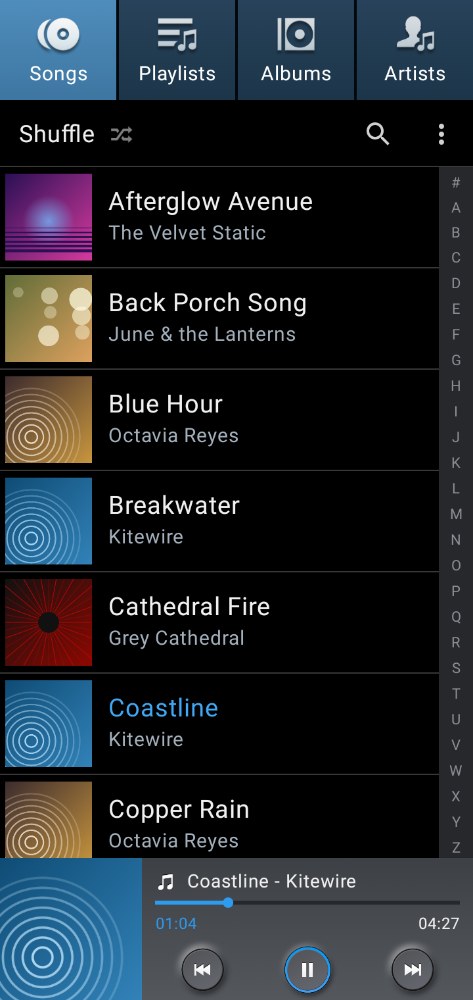
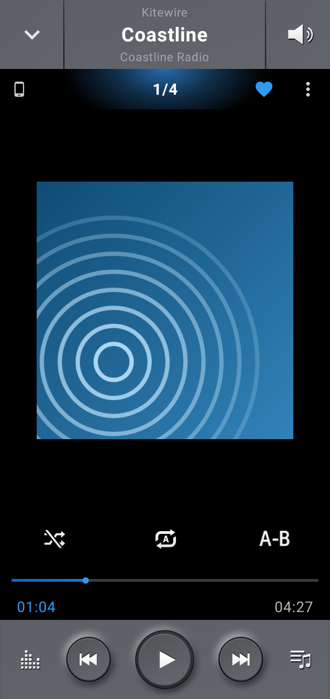
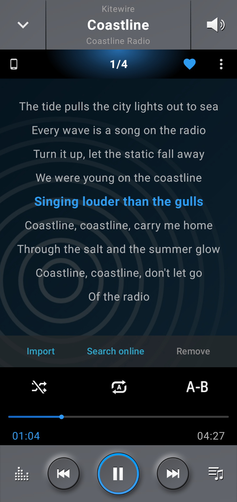
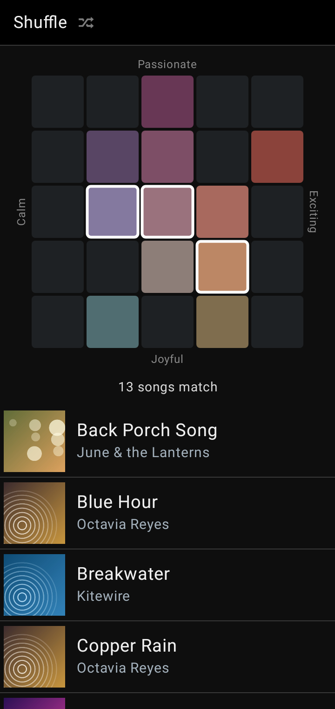
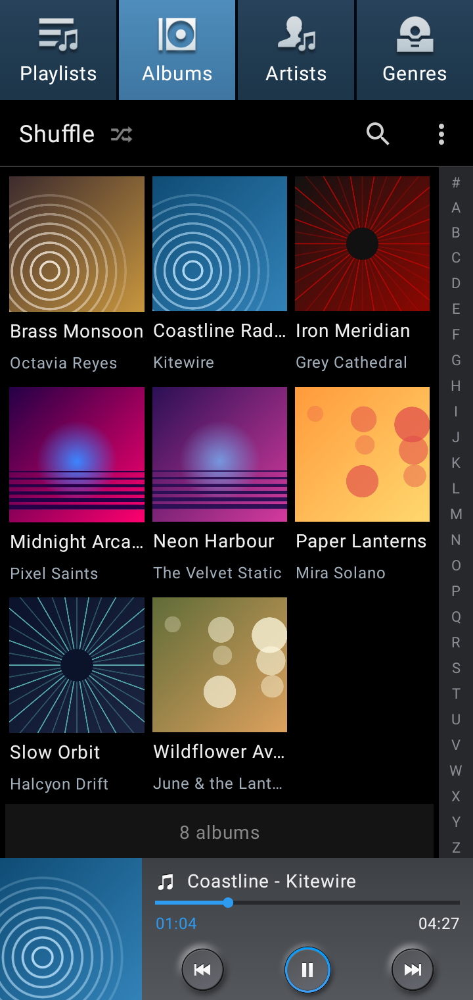
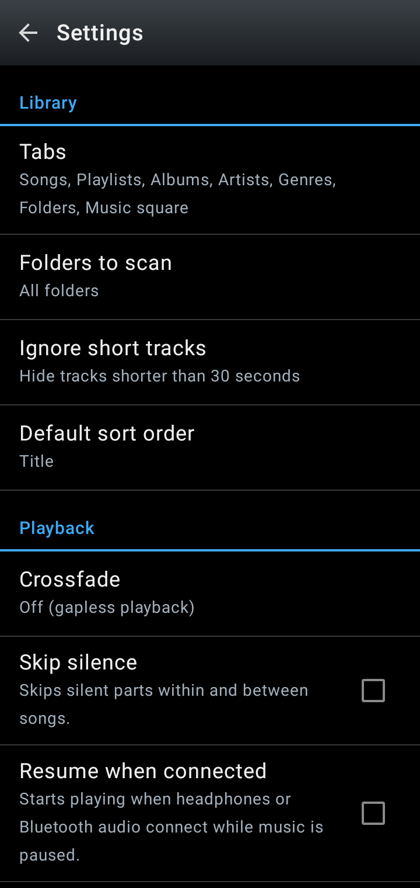
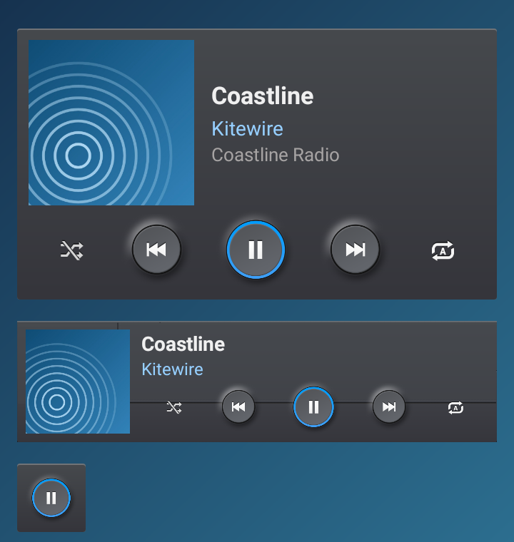

# Music Player (TouchWiz classic)



A from-scratch Kotlin rebuild of the classic Samsung TouchWiz music player (Galaxy S3 / S4 / Grand Quattro era) for modern Android (Android 11 and newer).

The original app's behaviour, layout and colours were studied from its APK, and the app was rewritten with Jetpack Compose and Media3. It contains no Samsung code.

<p align="center">
  
</p>

<p align="center">
  
  
  
  
</p>
<p align="center">
  
  
  
</p>

<sub>Screenshots use a made-up demo library (invented songs and artists, generated cover art).</sub>

## Features

**Library**
- TouchWiz icon tabs: Songs, Playlists, Albums, Artists, Genres, Folders, plus optional **Composers** and **Music Square**
- Large song rows, a **# A–Z index bar** with the TouchWiz letter bubble (also shown while flinging long lists), a shuffle row and search
- Updates by itself when songs are added or removed
- **Settings:** choose tabs, folders to scan, hide short tracks (voice notes, ringtones), default sort order

**Music Square**
- The S4's 5×5 mood grid, styled like the original: Exciting at the top, Calm at the bottom, Passionate on the left, Joyful on the right
- Tap a square and its songs start playing; drag across several squares to play them all. Pressed squares glow until you pick another; an empty one says no songs match that mood
- Songs are placed by genre and BPM tags plus an automatic on-device analysis (tempo, level, brightness). Nothing leaves the phone.

**Now Playing**
- The TouchWiz layout with shuffle, repeat, A-B repeat, seek bar, press-and-hold fast scrub, and a queue view
- **Favourites** heart, synced **lyrics over the album art**, and an output indicator that opens Android's output switcher
- Mini player at the bottom of the library

**Sound**
- **SoundAlive:** 13 presets, a 10-band user EQ with preamp and left/right balance, bass and 3D
- **Smart volume:** evens out loudness using ReplayGain tags (track or album)
- **Crossfade** (1–12 s) or gapless playback, and **skip silence**
- Optional separate SoundAlive setting per output (speaker, headphones, each Bluetooth device)
- **Play speed** (0.5x–2.0x)
- **Music auto off** (sleep timer) that fades out, or stops after the current song

**Playlists**
- Create, rename and delete, plus Favourites, Most played, Recently played and Recently added
- **Import and export `.m3u` / `.m3u8`**: playlists from other players and PCs are matched to your songs

**Files**
- **Edit track info:** file name, title, artist, album, genre, year and **cover art** (one song or a whole album), written into the file itself
- **Set as** ringtone, notification or alarm sound, with a start point and length (MP3 and AAC are trimmed without re-encoding)
- **Delete** songs, albums and folders (through Android's own confirmation)

**Lyrics**
- Import `.lrc` / `.txt` files, read lyrics embedded in the file, or search online at [LRCLIB](https://lrclib.net)
- Online search only runs after you agree, and can be turned off in Settings

**Everywhere else**
- **Widgets** in the classic TouchWiz style: 4×1, 4×2 with large album art, and 1×1 play/pause
- **Android Auto** and other media browsers: browse songs, albums, artists, playlists and recently played, and search; voice "play …" requests work too
- Background playback with notification, lock screen and Bluetooth/headset controls; resumes the last queue
- Optional **resume when headphones or Bluetooth connect**
- Touch vibration on buttons, long-presses and seeking (can be turned off)
- Ready to translate: all text is in `strings.xml`

## Building

Requirements: JDK 17 and the Android SDK (platform 35). Android Studio works out of the box.

```bash
./gradlew assembleRelease
# APK: app/build/outputs/apk/release/app-release.apk
```

### Release signing

Release builds are signed with the key described in a `keystore.properties` file in the project root. This file is git-ignored and must never be committed:

```properties
storeFile=C:/path/to/your-release.jks
storePassword=...
keyAlias=...
keyPassword=...
```

If the file is missing, release builds fall back to your local debug key. That's fine for testing, but those APKs can't install over the official releases.

### Tests and screenshots

Unit tests (playlist import, ReplayGain, MP3 trimming, Music Square) and off-device screenshot tests (Robolectric + Roborazzi) run on the PC:

```bash
./gradlew testDebugUnitTest
```

The screenshots in this README are rendered by `ShowcaseScreens` into `app/build/showcase/`:

```bash
./gradlew testDebugUnitTest --tests "*ShowcaseScreens*"
```

## Project layout

| Path | Contents |
|---|---|
| `app/src/main/java/dev/s4music/player/data` | MediaStore library, settings, playlists and `.m3u`, favourites, play stats, tag/cover editing, lyrics, Music Square analysis, ringtone maker |
| `.../playback` | `PlaybackService` (Media3 library service and Android Auto browse tree), crossfade, SoundAlive effects, ReplayGain, output routes |
| `.../widget` | Home screen widgets |
| `.../ui` | Compose screens: library, now playing, Music Square, settings, dialogs |

## Promo material

Graphics and videos for sharing the app are in [`docs/promo`](docs/promo):

| File | Size | For |
|---|---|---|
| [`promo_vertical.mp4`](docs/promo/promo_vertical.mp4) | 1080×1920, 28 s | Shorts, Reels, TikTok, stories |
| [`promo_landscape.mp4`](docs/promo/promo_landscape.mp4) | 1920×1080, 28 s | YouTube, X, websites |
| [`promo.gif`](docs/promo/promo.gif) | 720×405 | READMEs and forums |
| [`banner.png`](docs/promo/banner.png) | 1280×640 | GitHub social preview, headers |
| [`feature_graphic.png`](docs/promo/feature_graphic.png) | 1024×500 | Store-style feature graphic |
| [`cards/`](docs/promo/cards) | 1080×1350 | One post per feature |

They're built from the demo-library screenshots by `tools/promo/make_promo.py` (Pillow, NumPy and imageio-ffmpeg); see the script's header to rebuild them.

## Support

The app is free and always will be. If you enjoy it and want to say thanks, you can buy me a coffee:

[](https://ko-fi.com/idontkn0wbro)

The same link is in the app under **Settings → About → Support the app**.

## Disclaimer

This is an unofficial fan project, not affiliated with or endorsed by Samsung.

The launcher icon and the TouchWiz interface graphics (`app/src/main/res/drawable-*/tw_*`) were taken from Samsung's original Music Player APK. They are Samsung's copyrighted property and are included only to recreate the original look. All other code is original.

## License

The source code is released under the [MIT License](LICENSE). The license covers the original code only. It does **not** cover the Samsung graphics described above, which remain Samsung's property.

## Download

**[Download MusicPlayer-v4.2.5.apk](https://github.com/id0ntknowbr0/music-player-touchwiz/releases/download/v4.2.5/MusicPlayer-v4.2.5.apk)**, or see the [latest release](https://github.com/id0ntknowbr0/music-player-touchwiz/releases/latest) for what's new.

It installs on Android 11 or newer; you'll need to allow installing from unknown sources. Updates install directly over v4.1 and later.
